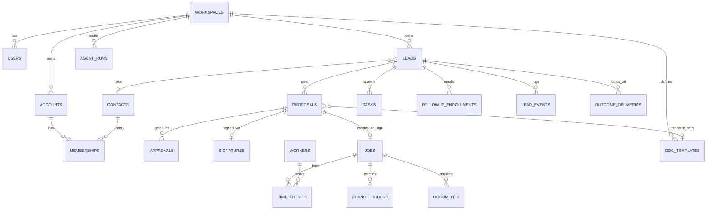

# Workpile — Database Schema & Entity Relationships

Generated from the schema definitions in the production codebase (commit `6155c8a`). The pilot runs SQLite (`node:sqlite`); a PostgreSQL DDL + migration pack with the same model ships in the repo for production scale.

## Tenancy & conventions

- Every business table carries `workspace_id` — the tenant key. All queries are workspace-scoped.

- Primary keys are opaque prefixed ids (`lead_…`, `ws_…`, `usr_…`, `prop_…`) generated in `db.ts`.

- Relationships are enforced in application code (SQLite foreign keys are declared on core tables); `*_id` columns below are the relationship carriers.

- JSON columns (suffixed patterns like `line_items`, `permissions_json`, `summary_json`, `custom`) store structured payloads documented in the module specs.

## Entity-relationship overview (core graph)

## Tables

### accounts (10 columns)

| Column | Type |
|---|---|
| id | TEXT |
| CREATE | TABLE |
| CREATE | TABLE |
| CREATE | TABLE |
| CREATE | TABLE |
| CREATE | TABLE |
| CREATE | TABLE |
| CREATE | TABLE |
| CREATE | TABLE |
| CREATE | TABLE |

### activities (9 columns)

| Column | Type |
|---|---|
| id | TEXT |
| CREATE | TABLE |
| CREATE | TABLE |
| CREATE | TABLE |
| CREATE | TABLE |
| CREATE | TABLE |
| CREATE | TABLE |
| CREATE | TABLE |
| CREATE | TABLE |

### agent_runs (11 columns)

| Column | Type |
|---|---|
| id | TEXT |
| CREATE | TABLE |
| CREATE | TABLE |
| CREATE | TABLE |
| CREATE | TABLE |
| CREATE | TABLE |
| CREATE | TABLE |
| CREATE | TABLE |
| CREATE | TABLE |
| CREATE | TABLE |
| CREATE | TABLE |

### api_keys (11 columns)

| Column | Type |
|---|---|
| id | TEXT |
| CREATE | TABLE |
| CREATE | TABLE |
| CREATE | TABLE |
| CREATE | TABLE |
| CREATE | TABLE |
| CREATE | TABLE |
| CREATE | TABLE |
| CREATE | TABLE |
| CREATE | TABLE |
| CREATE | TABLE |

### approvals (8 columns)

| Column | Type |
|---|---|
| id | TEXT |
| CREATE | TABLE |
| CREATE | TABLE |
| CREATE | TABLE |
| CREATE | TABLE |
| CREATE | TABLE |
| CREATE | TABLE |
| CREATE | TABLE |

### assignment_rules (4 columns)

| Column | Type |
|---|---|
| id | TEXT |
| CREATE | TABLE |
| CREATE | TABLE |
| CREATE | TABLE |

### audit_log (10 columns)

| Column | Type |
|---|---|
| id | TEXT |
| CREATE | TABLE |
| CREATE | TABLE |
| CREATE | TABLE |
| CREATE | TABLE |
| CREATE | TABLE |
| CREATE | TABLE |
| CREATE | TABLE |
| CREATE | TABLE |
| CREATE | TABLE |

### auth_tokens (9 columns)

| Column | Type |
|---|---|
| id | TEXT |
| CREATE | TABLE |
| CREATE | TABLE |
| CREATE | TABLE |
| CREATE | TABLE |
| CREATE | TABLE |
| CREATE | TABLE |
| CREATE | TABLE |
| CREATE | TABLE |

### callbacks (1 columns)

| Column | Type |
|---|---|
| id | TEXT |

### campaign_members (5 columns)

| Column | Type |
|---|---|
| id | TEXT |
| CREATE | TABLE |
| CREATE | TABLE |
| CREATE | TABLE |
| CREATE | TABLE |

### campaigns (6 columns)

| Column | Type |
|---|---|
| id | TEXT |
| CREATE | TABLE |
| CREATE | TABLE |
| CREATE | TABLE |
| CREATE | TABLE |
| CREATE | TABLE |

### canned_replies (2 columns)

| Column | Type |
|---|---|
| id | TEXT |
| CREATE | TABLE |

### change_orders (10 columns)

| Column | Type |
|---|---|
| id | TEXT |
| CREATE | TABLE |
| CREATE | TABLE |
| CREATE | TABLE |
| CREATE | TABLE |
| CREATE | TABLE |
| CREATE | TABLE |
| CREATE | TABLE |
| CREATE | TABLE |
| CREATE | TABLE |

### contacts (11 columns)

| Column | Type |
|---|---|
| id | TEXT |
| CREATE | TABLE |
| CREATE | TABLE |
| CREATE | INDEX |
| CREATE | INDEX |
| CREATE | TABLE |
| CREATE | TABLE |
| CREATE | TABLE |
| CREATE | TABLE |
| CREATE | TABLE |
| CREATE | TABLE |

### custom_fields (7 columns)

| Column | Type |
|---|---|
| id | TEXT |
| CREATE | TABLE |
| CREATE | TABLE |
| CREATE | TABLE |
| CREATE | TABLE |
| CREATE | TABLE |
| CREATE | TABLE |

### dashboard_pins (1 columns)

| Column | Type |
|---|---|
| id | TEXT |

### doc_templates (1 columns)

| Column | Type |
|---|---|
| id | TEXT |

### documents (10 columns)

| Column | Type |
|---|---|
| id | TEXT |
| CREATE | TABLE |
| CREATE | TABLE |
| CREATE | TABLE |
| CREATE | TABLE |
| CREATE | TABLE |
| CREATE | TABLE |
| CREATE | TABLE |
| CREATE | TABLE |
| CREATE | TABLE |

### favorites (2 columns)

| Column | Type |
|---|---|
| id | TEXT |
| CREATE | TABLE |

### feature_flags (11 columns)

| Column | Type |
|---|---|
| workspace_id | TEXT |
| CREATE | TABLE |
| CREATE | TABLE |
| CREATE | TABLE |
| CREATE | TABLE |
| CREATE | TABLE |
| CREATE | TABLE |
| CREATE | TABLE |
| CREATE | TABLE |
| CREATE | TABLE |
| CREATE | TABLE |

### feed_posts (9 columns)

| Column | Type |
|---|---|
| id | TEXT |
| CREATE | TABLE |
| CREATE | TABLE |
| CREATE | TABLE |
| CREATE | TABLE |
| CREATE | TABLE |
| CREATE | TABLE |
| CREATE | TABLE |
| CREATE | TABLE |

### field_reports (11 columns)

| Column | Type |
|---|---|
| id | TEXT |
| CREATE | TABLE |
| CREATE | TABLE |
| CREATE | TABLE |
| CREATE | TABLE |
| CREATE | TABLE |
| CREATE | TABLE |
| CREATE | TABLE |
| CREATE | TABLE |
| CREATE | TABLE |
| CREATE | TABLE |

### follows (8 columns)

| Column | Type |
|---|---|
| id | TEXT |
| CREATE | TABLE |
| CREATE | TABLE |
| CREATE | TABLE |
| CREATE | TABLE |
| CREATE | TABLE |
| CREATE | TABLE |
| CREATE | TABLE |

### followup_enrollments (8 columns)

| Column | Type |
|---|---|
| id | TEXT |
| CREATE | TABLE |
| CREATE | TABLE |
| CREATE | TABLE |
| CREATE | TABLE |
| CREATE | TABLE |
| CREATE | TABLE |
| CREATE | TABLE |

### imports (11 columns)

| Column | Type |
|---|---|
| id | TEXT |
| CREATE | TABLE |
| CREATE | TABLE |
| CREATE | TABLE |
| CREATE | TABLE |
| CREATE | TABLE |
| CREATE | TABLE |
| CREATE | TABLE |
| CREATE | TABLE |
| CREATE | TABLE |
| CREATE | TABLE |

### inbox_comments (4 columns)

| Column | Type |
|---|---|
| id | TEXT |
| CREATE | TABLE |
| CREATE | TABLE |
| CREATE | TABLE |

### inbox_items (10 columns)

| Column | Type |
|---|---|
| id | TEXT |
| CREATE | TABLE |
| CREATE | TABLE |
| CREATE | TABLE |
| CREATE | TABLE |
| CREATE | TABLE |
| CREATE | TABLE |
| CREATE | TABLE |
| CREATE | TABLE |
| CREATE | TABLE |

### inbox_rules (3 columns)

| Column | Type |
|---|---|
| id | TEXT |
| CREATE | TABLE |
| CREATE | TABLE |

### job_crew (10 columns)

| Column | Type |
|---|---|
| id | TEXT |
| CREATE | TABLE |
| CREATE | TABLE |
| CREATE | TABLE |
| CREATE | TABLE |
| CREATE | TABLE |
| CREATE | TABLE |
| CREATE | TABLE |
| CREATE | TABLE |
| CREATE | TABLE |

### job_schedule (10 columns)

| Column | Type |
|---|---|
| id | TEXT |
| CREATE | TABLE |
| CREATE | TABLE |
| CREATE | TABLE |
| CREATE | TABLE |
| CREATE | TABLE |
| CREATE | TABLE |
| CREATE | TABLE |
| CREATE | TABLE |
| CREATE | TABLE |

### jobs (5 columns)

| Column | Type |
|---|---|
| id | TEXT |
| CREATE | TABLE |
| CREATE | TABLE |
| CREATE | TABLE |
| CREATE | TABLE |

### labor_classes (11 columns)

| Column | Type |
|---|---|
| id | TEXT |
| CREATE | TABLE |
| CREATE | TABLE |
| CREATE | TABLE |
| CREATE | TABLE |
| CREATE | TABLE |
| CREATE | TABLE |
| CREATE | TABLE |
| CREATE | TABLE |
| CREATE | TABLE |
| CREATE | TABLE |

### lead_events (10 columns)

| Column | Type |
|---|---|
| id | TEXT |
| CREATE | TABLE |
| CREATE | TABLE |
| CREATE | TABLE |
| CREATE | TABLE |
| CREATE | TABLE |
| CREATE | TABLE |
| CREATE | TABLE |
| CREATE | TABLE |
| CREATE | TABLE |

### leads (10 columns)

| Column | Type |
|---|---|
| id | TEXT |
| CREATE | INDEX |
| CREATE | INDEX |
| CREATE | TABLE |
| CREATE | TABLE |
| CREATE | TABLE |
| CREATE | TABLE |
| CREATE | TABLE |
| CREATE | TABLE |
| CREATE | TABLE |

### memberships (10 columns)

| Column | Type |
|---|---|
| user_id | TEXT |
| CREATE | TABLE |
| CREATE | TABLE |
| CREATE | TABLE |
| CREATE | TABLE |
| CREATE | TABLE |
| CREATE | TABLE |
| CREATE | TABLE |
| CREATE | TABLE |
| CREATE | TABLE |

### messages_outbox (10 columns)

| Column | Type |
|---|---|
| id | TEXT |
| CREATE | TABLE |
| CREATE | TABLE |
| CREATE | TABLE |
| CREATE | TABLE |
| CREATE | TABLE |
| CREATE | TABLE |
| CREATE | TABLE |
| CREATE | TABLE |
| CREATE | TABLE |

### notes (3 columns)

| Column | Type |
|---|---|
| id | TEXT |
| CREATE | TABLE |
| CREATE | TABLE |

### notifications (10 columns)

| Column | Type |
|---|---|
| id | TEXT |
| CREATE | TABLE |
| CREATE | TABLE |
| CREATE | TABLE |
| CREATE | TABLE |
| CREATE | TABLE |
| CREATE | TABLE |
| CREATE | TABLE |
| CREATE | TABLE |
| CREATE | TABLE |

### oauth_connections (11 columns)

| Column | Type |
|---|---|
| id | TEXT |
| CREATE | TABLE |
| CREATE | TABLE |
| CREATE | TABLE |
| CREATE | TABLE |
| CREATE | TABLE |
| CREATE | TABLE |
| CREATE | TABLE |
| CREATE | TABLE |
| CREATE | TABLE |
| CREATE | TABLE |

### outbox (11 columns)

| Column | Type |
|---|---|
| id | TEXT |
| CREATE | TABLE |
| CREATE | TABLE |
| CREATE | TABLE |
| CREATE | TABLE |
| CREATE | TABLE |
| CREATE | TABLE |
| CREATE | TABLE |
| CREATE | TABLE |
| CREATE | TABLE |
| CREATE | TABLE |

### outcome_deliveries (11 columns)

| Column | Type |
|---|---|
| id | TEXT |
| CREATE | TABLE |
| CREATE | TABLE |
| CREATE | TABLE |
| CREATE | TABLE |
| CREATE | TABLE |
| CREATE | TABLE |
| CREATE | TABLE |
| CREATE | TABLE |
| CREATE | TABLE |
| CREATE | TABLE |

### payments (10 columns)

| Column | Type |
|---|---|
| id | TEXT |
| CREATE | TABLE |
| CREATE | TABLE |
| CREATE | TABLE |
| CREATE | TABLE |
| CREATE | TABLE |
| CREATE | TABLE |
| CREATE | TABLE |
| CREATE | TABLE |
| CREATE | TABLE |

### portal_uploads (10 columns)

| Column | Type |
|---|---|
| id | TEXT |
| CREATE | TABLE |
| CREATE | TABLE |
| CREATE | TABLE |
| CREATE | TABLE |
| CREATE | TABLE |
| CREATE | TABLE |
| CREATE | TABLE |
| CREATE | TABLE |
| CREATE | TABLE |

### price_book_items (9 columns)

| Column | Type |
|---|---|
| id | TEXT |
| CREATE | TABLE |
| CREATE | TABLE |
| CREATE | TABLE |
| CREATE | TABLE |
| CREATE | TABLE |
| CREATE | TABLE |
| CREATE | TABLE |
| CREATE | TABLE |

### projects (10 columns)

| Column | Type |
|---|---|
| id | TEXT |
| CREATE | TABLE |
| CREATE | TABLE |
| CREATE | TABLE |
| CREATE | TABLE |
| CREATE | TABLE |
| CREATE | TABLE |
| CREATE | TABLE |
| CREATE | TABLE |
| CREATE | TABLE |

### proposals (9 columns)

| Column | Type |
|---|---|
| id | TEXT |
| CREATE | TABLE |
| CREATE | TABLE |
| CREATE | TABLE |
| CREATE | TABLE |
| CREATE | TABLE |
| CREATE | TABLE |
| CREATE | TABLE |
| CREATE | TABLE |

### push_subscriptions (7 columns)

| Column | Type |
|---|---|
| id | TEXT |
| CREATE | TABLE |
| CREATE | TABLE |
| CREATE | TABLE |
| CREATE | TABLE |
| CREATE | TABLE |
| CREATE | TABLE |

### services (9 columns)

| Column | Type |
|---|---|
| id | TEXT |
| CREATE | TABLE |
| CREATE | TABLE |
| CREATE | TABLE |
| CREATE | TABLE |
| CREATE | TABLE |
| CREATE | TABLE |
| CREATE | TABLE |
| CREATE | TABLE |

### sessions (11 columns)

| Column | Type |
|---|---|
| id | TEXT |
| CREATE | TABLE |
| CREATE | TABLE |
| CREATE | TABLE |
| CREATE | INDEX |
| CREATE | INDEX |
| CREATE | TABLE |
| CREATE | TABLE |
| CREATE | TABLE |
| CREATE | TABLE |
| CREATE | TABLE |

### signatures (10 columns)

| Column | Type |
|---|---|
| id | TEXT |
| CREATE | TABLE |
| CREATE | TABLE |
| CREATE | TABLE |
| CREATE | TABLE |
| CREATE | TABLE |
| CREATE | TABLE |
| CREATE | TABLE |
| CREATE | TABLE |
| CREATE | TABLE |

### site_visits (10 columns)

| Column | Type |
|---|---|
| id | TEXT |
| CREATE | TABLE |
| CREATE | TABLE |
| CREATE | TABLE |
| CREATE | TABLE |
| CREATE | TABLE |
| CREATE | TABLE |
| CREATE | TABLE |
| CREATE | TABLE |
| CREATE | TABLE |

### sources (11 columns)

| Column | Type |
|---|---|
| id | TEXT |
| CREATE | TABLE |
| CREATE | INDEX |
| CREATE | INDEX |
| CREATE | TABLE |
| CREATE | TABLE |
| CREATE | TABLE |
| CREATE | TABLE |
| CREATE | TABLE |
| CREATE | TABLE |
| CREATE | TABLE |

### subscriptions (11 columns)

| Column | Type |
|---|---|
| id | TEXT |
| CREATE | TABLE |
| CREATE | TABLE |
| CREATE | TABLE |
| CREATE | TABLE |
| CREATE | TABLE |
| CREATE | TABLE |
| CREATE | TABLE |
| CREATE | TABLE |
| CREATE | TABLE |
| CREATE | TABLE |

### tasks (9 columns)

| Column | Type |
|---|---|
| id | TEXT |
| CREATE | TABLE |
| CREATE | TABLE |
| CREATE | TABLE |
| CREATE | TABLE |
| CREATE | TABLE |
| CREATE | TABLE |
| CREATE | TABLE |
| CREATE | TABLE |

### templates (9 columns)

| Column | Type |
|---|---|
| id | TEXT |
| CREATE | TABLE |
| CREATE | TABLE |
| CREATE | TABLE |
| CREATE | TABLE |
| CREATE | TABLE |
| CREATE | TABLE |
| CREATE | TABLE |
| CREATE | TABLE |

### time_entries (10 columns)

| Column | Type |
|---|---|
| id | TEXT |
| CREATE | TABLE |
| CREATE | TABLE |
| CREATE | TABLE |
| CREATE | TABLE |
| CREATE | TABLE |
| CREATE | TABLE |
| CREATE | TABLE |
| CREATE | TABLE |
| CREATE | TABLE |

### timesheets (11 columns)

| Column | Type |
|---|---|
| id | TEXT |
| CREATE | TABLE |
| CREATE | TABLE |
| CREATE | TABLE |
| CREATE | TABLE |
| CREATE | TABLE |
| CREATE | TABLE |
| CREATE | TABLE |
| CREATE | TABLE |
| CREATE | TABLE |
| CREATE | TABLE |

### users (11 columns)

| Column | Type |
|---|---|
| id | TEXT |
| CREATE | TABLE |
| CREATE | TABLE |
| CREATE | TABLE |
| CREATE | TABLE |
| CREATE | INDEX |
| CREATE | INDEX |
| CREATE | TABLE |
| CREATE | TABLE |
| CREATE | TABLE |
| CREATE | TABLE |

### webhook_deliveries (10 columns)

| Column | Type |
|---|---|
| id | TEXT |
| CREATE | TABLE |
| CREATE | TABLE |
| CREATE | TABLE |
| CREATE | TABLE |
| CREATE | TABLE |
| CREATE | TABLE |
| CREATE | TABLE |
| CREATE | TABLE |
| CREATE | TABLE |

### webhook_endpoints (10 columns)

| Column | Type |
|---|---|
| id | TEXT |
| CREATE | TABLE |
| CREATE | TABLE |
| CREATE | TABLE |
| CREATE | TABLE |
| CREATE | TABLE |
| CREATE | TABLE |
| CREATE | TABLE |
| CREATE | TABLE |
| CREATE | TABLE |

### workers (6 columns)

| Column | Type |
|---|---|
| id | TEXT |
| CREATE | TABLE |
| CREATE | TABLE |
| CREATE | TABLE |
| CREATE | TABLE |
| CREATE | TABLE |

### workspaces (11 columns)

| Column | Type |
|---|---|
| id | TEXT |
| CREATE | TABLE |
| CREATE | TABLE |
| CREATE | TABLE |
| CREATE | TABLE |
| CREATE | TABLE |
| CREATE | INDEX |
| CREATE | INDEX |
| CREATE | TABLE |
| CREATE | TABLE |
| CREATE | TABLE |

---
*Column lists are extracted from the `CREATE TABLE` definitions in source; additive migration columns (e.g. `notifications.entity_type/entity_id`, `workspaces.logo_data`, `leads.custom`) are applied at startup and described in the module specifications.*
